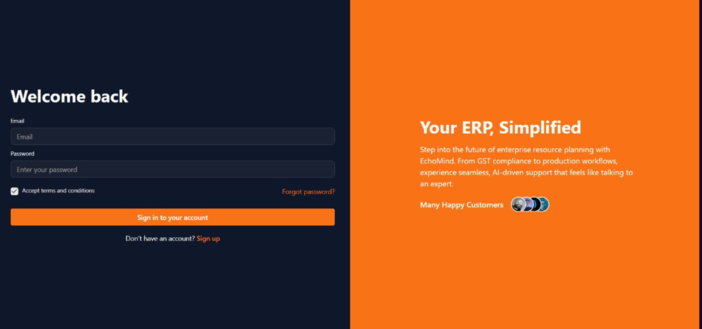
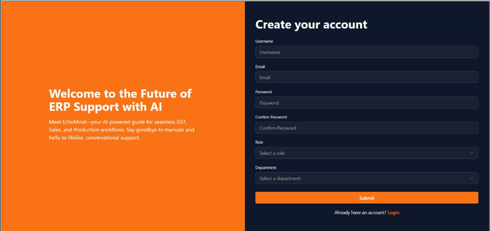
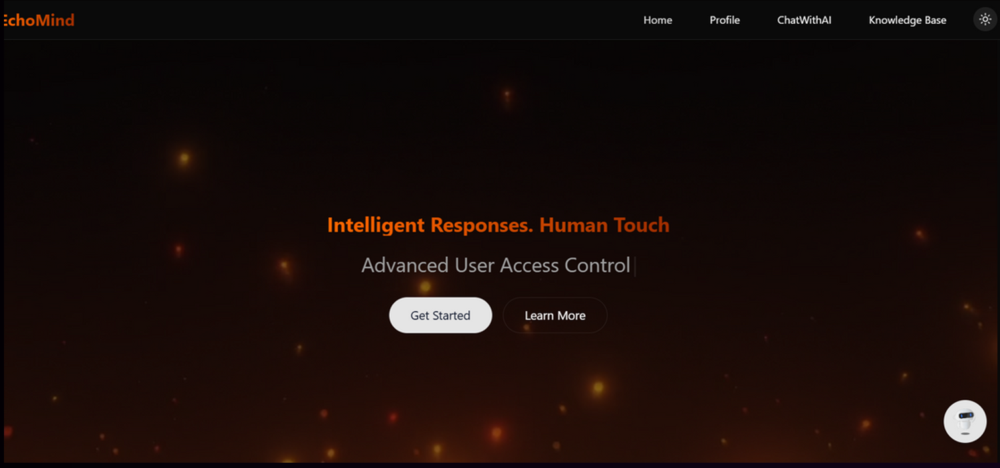
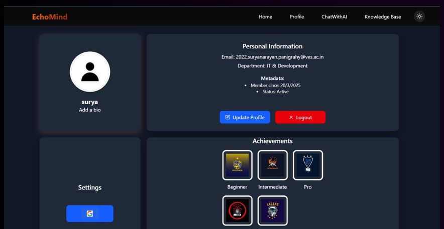
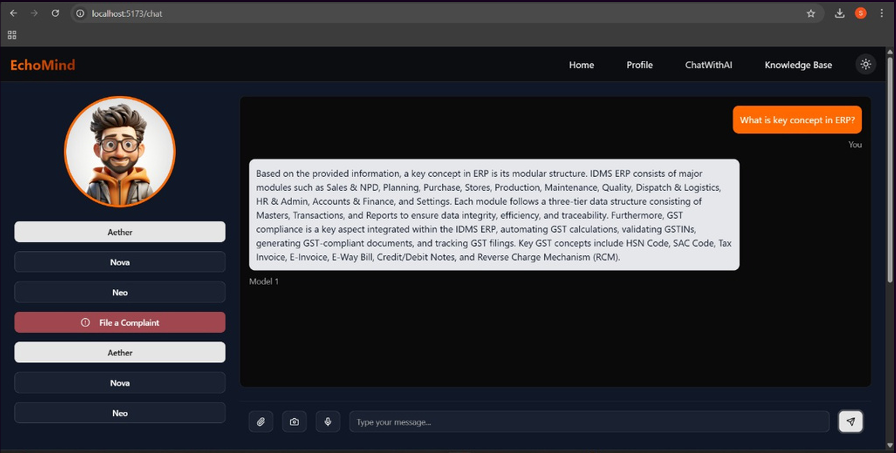
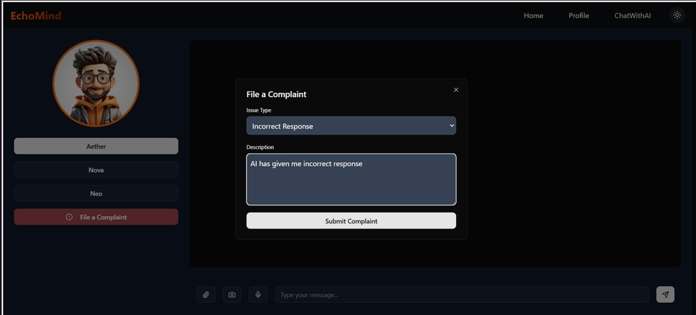
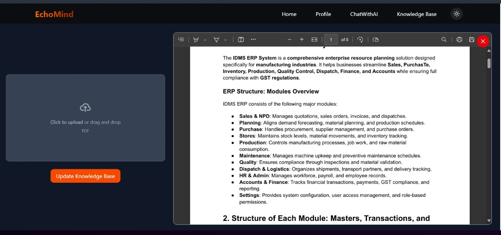

# 🤖 EchoMind – Intelligent Human-AI Interaction Platform

> Bridging the gap between automation and empathy with real-time emotion recognition and intelligent avatars.

---

## 🎥 Demo Video

👉 [Watch the Demo Video](https://www.youtube.com/watch?v=5ALPH1ZYjsE)

 [](https://www.youtube.com/watch?v=5ALPH1ZYjsE)


📄 **Project Presentation (PPT)**  
👉 [View PPT here](https://www.canva.com/design/DAGieVJ1_MI/MbB_RTxsjNv8DPWSk5i0ZA/edit)  

---

## 🧠 Overview

**EchoMind** is an intelligent, multi-role human-assistance platform built to simulate lifelike AI interaction with users. It combines role-based dashboards, speech-to-text processing, AI-powered avatars, and real-time emotion detection to deliver a personalized support system. Whether you're an employee, admin, or support staff, EchoMind offers a unique blend of automation with a human touch.

---

## 🚀 Features

- 🔐 **Secure Registration with OTP Verification**
- 👥 **Role-based Dashboards**: Employee, Admin, Support
- 🗣️ **Chat via Text & Voice**: Integrates Wav2Vec2 for transcription
- 🧑‍🎤 **AI-Powered Avatars**: Dynamic avatar responses using D-ID API
- 😃 **Emotion Recognition**: Real-time facial emotion analysis using OpenCV & GANs
- 🗂️ **Complaint Management System**
- 📚 **Knowledge Base Update Module** for Admins
- 📨 **Apology Email System** on response escalation

---

## 🖼️ Screenshots

> Preview of platform features :

### 🔐 Login Page  


### 📝 Signup Page  


### 🏠 Home Dashboard  


### 👤 User Profile Page  


### 🤖 AI Bot / Avatar Chat  


### 📝 Complaint System  


### 🛠️ Knowledge Base Update (Admin)  



## 🛠️ Tech Stack

### Frontend:
- React.js (MERN)
- Redux Toolkit

### Backend:
- Node.js & Express.js (REST APIs)
- MongoDB (Database)

### AI & Deep Learning:
- Flask
- PyTorch
- OpenCV
- Deepfake GANs
- Langchain
- Wav2Vec2
- D-ID API (Avatar Generation)

---

## ⚙️ How to Run Locally

### Prerequisites:
- Node.js
- Python 3.8+
- MongoDB (Local or Cloud)
- pip (for Python packages)

### Steps:

```bash
# Clone the repository
git clone https://github.com/your-username/EchoMind.git
cd EchoMind

# Install Frontend
cd client
npm install
npm start

# Install Backend
cd ../server
npm install
node index.js

# Install AI Backend
cd ../ai-engine
pip install -r requirements.txt
python app.py